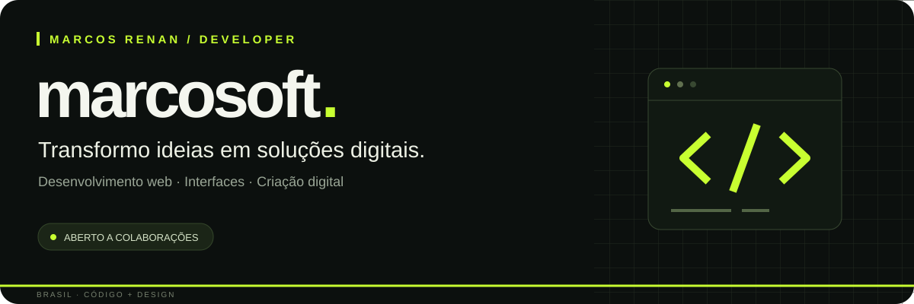
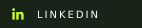

  

  
  
  

  <a href="#sobre">Sobre</a> ·
  <a href="#projetos">Projetos</a> ·
  <a href="#tecnologias">Tecnologias</a> ·
  <a href="#servicos">Serviços</a> ·
  <a href="#contato">Contato</a>

 

## Olá, eu sou o Marcos Renan!

Sou **desenvolvedor web em formação** e estudante de **Análise e Desenvolvimento de Sistemas na UNIASSELVI**. Gosto de unir código e design para criar interfaces claras, responsivas e com personalidade.

Estou construindo a **[MarcoSoft Developer](https://marcosoft.pages.dev/)**, minha marca independente de desenvolvimento e criação digital. Por aqui, compartilho projetos, experimentos e minha evolução na prática.

- **Meu foco:** front-end, sites institucionais, portfólios e landing pages.
- **Meu lado criativo:** interfaces, artes digitais e identidade visual.
- **Estou aprofundando:** JavaScript, Git, GitHub e fundamentos de desenvolvimento Full Stack.
- **Também exploro:** automação, aplicações de IA e desenvolvimento de jogos 2D.
- **Aberto a:** trabalhos freelance, colaborações e oportunidades de aprendizado.

 

## Projetos em destaque

### 01 / MarcoSoft Developer
**Minha marca, meus serviços e minha direção como desenvolvedor.**

Site de apresentação da MarcoSoft, reunindo serviços de desenvolvimento e criação digital, projetos e canais de contato para novas parcerias.

**Foco:** apresentação de serviços · identidade visual · experiência responsiva

[Conhecer a MarcoSoft →](https://marcosoft.pages.dev/)

---

### 02 / Portfólio pessoal
**Um registro da minha evolução com desenvolvimento web.**

Portfólio com apresentação pessoal, formação, tecnologias, projeto em destaque e contato. Construído com HTML, CSS e JavaScript, com publicação no GitHub Pages.

**Tecnologias:** HTML5 · CSS3 · JavaScript · GitHub Pages

[Ver o projeto →](https://marcosrngit.github.io/) · [Explorar o código →](https://github.com/Marcosrngit/marcosrngit.github.io)

 

## Tecnologias e ferramentas

  
  
  
  
  

| Área | O que estou praticando |
| :--- | :--- |
| **Estrutura e estilo** | HTML semântico, CSS, layouts responsivos e adaptação para celular |
| **Interatividade** | JavaScript, navegação, eventos e comportamento de interfaces |
| **Versionamento** | Git, organização de repositórios e publicação com GitHub |
| **Criação visual** | Canva, Lightroom, composição e identidade visual |
| **Novos estudos** | Automação, IA aplicada e desenvolvimento de jogos 2D |

### Meu próximo passo

Aprofundar JavaScript, melhorar a acessibilidade e a experiência no celular, documentar melhor meus projetos e avançar nos fundamentos de back-end.

 

## Como posso contribuir com seu projeto

| Desenvolvimento web | Design e criação digital |
| :--- | :--- |
| Sites institucionais e páginas de apresentação | Interfaces e layouts para web |
| Landing pages para divulgar serviços | Artes para redes sociais |
| Portfólios pessoais e profissionais | Identidade visual para projetos |
| Ajustes de layout e responsividade | Materiais digitais de divulgação |

**Da ideia à publicação:** entender o objetivo, organizar o conteúdo, definir o visual, desenvolver e revisar a experiência em diferentes telas.

Tem um projeto em mente? Podemos conversar sobre o que você precisa e definir um escopo adequado.

 

## Atividade no GitHub

  
  

Estatísticas dos repositórios públicos, atualizadas pelo fluxo de automação deste perfil. Linguagens dos repositórios não representam nível de domínio.

  

## Vamos construir algo juntos?

**Sites, interfaces ou uma ideia que precisa sair do papel.** Me conte o que você está planejando.

- **WhatsApp:** [Conversar sobre um projeto](https://wa.me/5564999593262?text=Ol%C3%A1%2C%20Marcos%21%20Vi%20seu%20GitHub%20e%20gostaria%20de%20conversar%20sobre%20um%20projeto.)
- **E-mail:** [contato.marcosrn@gmail.com](mailto:contato.marcosrn@gmail.com)
- **LinkedIn:** [Conectar comigo](https://www.linkedin.com/in/marcos-renan-2b5941308/)
- **Instagram:** [@marcosrenanzr](https://www.instagram.com/marcosrenanzr/)
- **Portfólio:** [marcosoft.pages.dev](https://marcosoft.pages.dev/)

---

  <strong>MarcoSoft Developer</strong> 
  Código com propósito. Design com identidade. Aprendizado contínuo.

